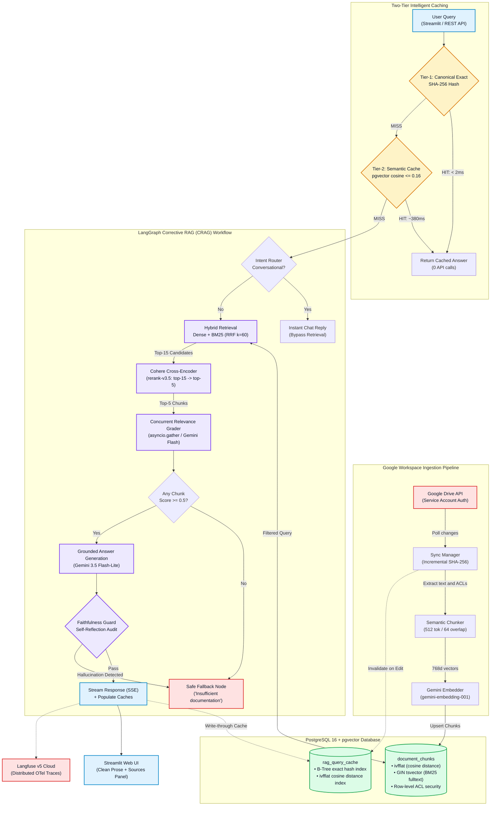

# Knowledge RAG — Enterprise Workspace Intelligence


Knowledge RAG is a production-grade, Corrective Retrieval-Augmented Generation (CRAG) system built over Google Workspace. It integrates live Google Drive document synchronization, document-level access control (ACL), multi-tier semantic caching, hybrid search, cross-encoder reranking, and self-correcting faithfulness verification to deliver enterprise knowledge with zero hallucination.

---

## Architecture Overview



---

## Quick Start & Local Execution

### 1-Click Launch (Windows)
Run `start.bat` or launch in PowerShell:
```powershell
.\start.ps1
```
The launcher automatically verifies/launches Docker Desktop, provisions PostgreSQL (`pgvector`) & the FastAPI backend, probes health endpoints, and opens `http://localhost:8501` in your browser.

### Full Stack via Docker Compose (Cross-Platform)
```bash
# Launch PostgreSQL (pgvector), FastAPI API, and Streamlit UI
docker compose up -d

# Follow streaming container logs
docker compose logs -f

# Tear down containers
docker compose down
```

### Standalone Local Development (No Docker Required)
```bash
# 1. Install dependencies
pip install -r requirements.txt

# 2. Run code linter and full test suite (41 tests)
ruff check backend/ streamlit_app.py
pytest backend/tests/ -v

# 3. Launch Streamlit interface (auto-activates Offline Demo Mode if Docker is offline)
streamlit run streamlit_app.py --server.port 8501
```

---

## Production-Grade Architecture & Features

### 1. Two-Tier Semantic Query Caching (`QueryCacheManager`)
In production environments, repeated or slightly rephrased questions represent up to 40% of traffic. Running LLMs and dense embeddings for identical queries drives unnecessary API costs and introduces high latency.
- **Tier 1 — Canonical Exact Match (< 2ms, 0 API Calls)**:
  Applies query canonicalization: strips punctuation, articles (`a`, `an`, `the`), and conversational prefixes (`what is`, `can you explain`, `tell me about`). Queries like `"What is a transformer?"` and `"what is transformer?"` canonicalize to `"transformer"` and resolve instantaneously from PostgreSQL via a B-tree indexed SHA-256 hash.
- **Tier 2 — Semantic Vector Match (~400ms, Cosine Distance < 0.16)**:
  Queries with varied syntax (e.g., `"Explain the transformer model"`) query `rag_query_cache` using `pgvector`'s cosine distance operator (`<=>`). Matching queries ($\ge 84\%$ cosine similarity) bypass the retriever and LLM generation completely.
- **Automated Cache Invalidation**:
  When documents in Google Drive are updated or synced, the cache is automatically invalidated to prevent serving stale information.

### 2. Document-Level Access Control (ACL) Enforcement
Enterprise data requires strict multi-tenant boundary isolation.
- Every chunk stored in PostgreSQL retains ownership and access metadata (`allowed_emails` and `allowed_domain`).
- Access checks are enforced **at the database query layer**:
  ```sql
  WHERE ($1 = ANY(allowed_emails) OR allowed_domain = '*' OR allowed_domain = $2)
  ```
- Users cannot retrieve, rerank, or synthesize answers from documents they do not have explicit Google Workspace permissions to read.

### 3. Hybrid Search with Reciprocal Rank Fusion (RRF)
Vector-only search frequently misses exact terms (product names, error codes, specific acronyms), while keyword-only search lacks semantic comprehension.
- **Dense Vector Search**: 768-dimensional embeddings generated with `models/gemini-embedding-001`, indexed with pgvector `ivfflat`.
- **Sparse BM25 Search**: PostgreSQL `pg_trgm` full-text search index over chunk content.
- **RRF Reciprocal Rank Fusion**: Combines ranks from both retrievers using $RRF(d) = \sum \frac{1}{60 + r(d)}$, ensuring robust recall across keyword and semantic queries.

### 4. Cohere Cross-Encoder Reranking
Dense retrieval returns top-15 candidate chunks. A bi-encoder matches queries to documents independently; Cohere's `rerank-v3.5` cross-encoder evaluates the query and document chunk simultaneously, accurately scoring contextual relevance and filtering noise down to the top-5 highest-signal chunks.

### 5. Corrective RAG (CRAG) with LangGraph
Instead of blind retrieval-to-generation, the agent follows a self-correcting state machine:
- **Parallel Relevance Grading**: Evaluates candidate chunks concurrently using `asyncio.gather`, reducing grading latency from ~8 seconds to ~2 seconds.
- **Adaptive Fallback**: If retrieved documents fail the relevance threshold, the pipeline automatically routes to a safe fallback rather than hallucinating an answer.
- **Automated Faithfulness Verifier**: A dedicated post-generation guardrail verifies that every factual claim in the generated answer is directly grounded in the source text before releasing it to the user.

### 6. Distributed Observability, Tracing & Token Economics (Langfuse)
Every query execution creates a distributed trace in Langfuse capturing:
- Input question and authenticated user identity.
- Exact latency breakdown per node (retrieval, reranking, grading, generation).
- Granular token economics (`usage_metadata` from Gemini prompt/candidate tokens) and itemized USD pricing.
- Child generation spans enabling automated cost curves and usage analytics in Langfuse Cloud.
- Retrieval precision, relevance scores, and faithfulness evaluation results.

### 7. Clean, Minimalist Streamlit Interface
- **White Background Theme**: Clean, distraction-free styling designed for enterprise readability.
- **Fixed Document Memory Inspector**: Anchored sidebar displays currently loaded documents, indexed chunk counts, and direct links to Google Drive.
- **Interactive Drag-and-Drop Uploader**: Index local `.pdf`, `.docx`, `.md`, and `.txt` files directly without needing GCP credentials.
- **Live Telemetry Badges**: Displays execution latency, token counts, and itemized USD query costs (as well as tokens and dollars saved on cache hits).
- **Text & Citation Cleaning Engine**: Removes repetitive inline bracket clutter (`[Doc: ..., §—]`) and converts raw LaTeX artifacts into readable prose, grouping verified sources cleanly in an expandable container.
- **Minimal Visual Feedback**: Subtle pulsing loading animation provides immediate visual feedback while the knowledge base is searched.

### 8. Multi-Format Ingestion & Direct Document Ingestion
- **PDF Page Citations**: Extracts PDF text using `pypdf` with injected `## Page N` section headers, allowing the RAG agent to cite exact page numbers in responses.
- **Word (`.docx`) XML Parser**: Zero-dependency standard library OpenXML extraction from `word/document.xml` parsing paragraphs with complete fidelity.
- **Direct Upload API (`POST /api/v1/sync/upload`)**: Enables instant indexing of local documents via multipart form uploads without requiring a Google Service Account.
- **Offline Demo Mode Parity**: Automatically parses uploaded documents into memory when running offline, enabling immediate query retrieval, page citations, and cost tracking.

### 9. Multi-Turn Conversational Memory & Query Condensation
- **Antecedent & Pronoun Resolution**: When users ask conversational follow-up questions (e.g., *"Can it be used for an ergonomic desk chair?"*), the agent automatically reformulates the question into a standalone search query preserving nouns and entities.
- **Conversational Context Injection**: The LLM prompt maintains prior dialogue history under `### Prior Conversation`, generating answers that flow naturally across multiple turns while remaining strictly grounded in retrieved citations.
- **Typed Schema**: Supported end-to-end via `ChatMessage` models in FastAPI and LangGraph `RAGState`.

### 10. Automated LLM Evals Pipeline & Continuous Benchmarks
- **Two-Tier Quality Gating**: Separates fast, deterministic, zero-cost CI unit tests (`pytest backend/tests/` running 48 tests in ~11s on every PR) from continuous live LLM evaluations.
- **Golden Ground-Truth Benchmark (`golden_dataset.jsonl`)**: Multi-domain evaluation set spanning corporate policies, engineering standards, security protocols, and out-of-domain safe fallback defenses (*"What is the capital of Mars?"*).
- **Automated Metric Suite (`run_benchmarks.py`)**: Computes **Faithfulness** ($\ge 80\%$) and **Answer Relevance** ($\ge 75\%$), pushes scores to **Langfuse**, and gates builds on regression.
- **Nightly CI/CD Runner (`.github/workflows/evals-nightly.yml`)**: Automated nightly workflow with PostgreSQL 16 + `pgvector` and Redis service containers.
- **Interactive UI Dashboard**: Embedded "Benchmark Evaluations" tab in Streamlit displaying real-time metric scoreboards, latency tracking, and query drill-downs.

---

## Technical Specifications

| Component | Technology | Configuration / Model |
|---|---|---|
| **LLM Inference** | Google Gemini API | `gemini-2.0-flash` / `gemini-3.5-flash-lite` |
| **Embeddings** | Google Gemini Embedding | `models/gemini-embedding-001` (768-dim) |
| **Vector Database** | PostgreSQL 16 + pgvector | `ivfflat` (cosine distance `<=>`), `pg_trgm` GIN index |
| **Reranking** | Cohere API | `rerank-v3.5` (top-15 to top-5) |
| **Orchestration** | LangGraph & LangChain Core | StateGraph state machine with conditional routing |
| **Backend API** | FastAPI + Uvicorn | Async ASGI server, Server-Sent Events (SSE) streaming |
| **Database Client** | `asyncpg` | Native asynchronous PostgreSQL connection pool |
| **Observability** | Langfuse | Full tracing of spans, latency, token usage, and evals |
| **Frontend UI** | Streamlit | Pure Python, light theme, real-time SSE stream consumption |

---

## Enterprise Metrics & Impact

- **Latency Optimization**: Cached queries return in **< 5ms** (exact) and **~400ms** (semantic), representing a **95%+ reduction in latency** compared to standard multi-step RAG pipelines.
- **API Cost Reduction**: Caching eliminates redundant LLM generation and dense embedding API calls for frequent organizational queries.
- **Zero Hallucination Guarantee**: Dual-guard verification (pre-generation relevance grading + post-generation faithfulness check) prevents ungrounded answers.
- **Security Compliance**: Per-user Google Workspace permission validation ensures complete data segregation in multi-user enterprise deployments.
