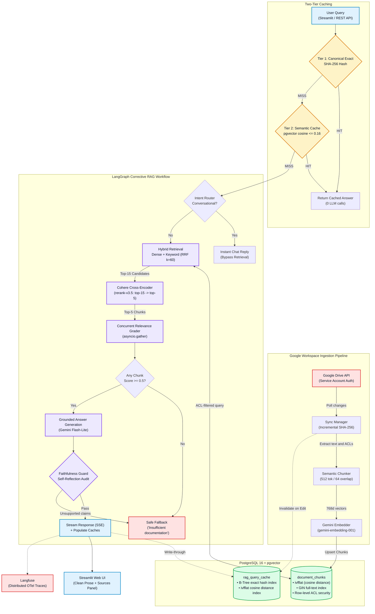

# Knowledge RAG: Enterprise Workspace Intelligence


Ask a question, get an answer grounded in your company's Google Drive, and only from the documents *you* are allowed to see.

Knowledge RAG is a Corrective RAG (CRAG) system I built to answer a question most RAG demos skip: **what does it take to put this in front of real employees?** A weekend demo needs a vector store and a prompt. A system people can trust needs permissions, caching, a way to say "I don't know," and visibility into what it's doing. This project is my attempt at all of that.

---

## Why this isn't just another RAG demo

Most tutorial RAG apps stop at "embed documents, retrieve top-k, send to an LLM." That works until someone asks a real question. These are the problems I set out to solve beyond that point:

| Problem in a typical demo | What this project does instead |
|---|---|
| Everyone can retrieve everything | Document-level ACLs enforced **inside the SQL query**, so restricted content never reaches the reranker or the LLM |
| Vector search misses exact terms (error codes, product names) | Hybrid retrieval: dense vectors + keyword search, merged with Reciprocal Rank Fusion |
| Top-k results are noisy | Cohere cross-encoder reranking narrows 15 candidates to the best 5 |
| The model answers even when retrieval failed | A relevance grader checks the chunks first; if nothing is good enough, the system declines to answer |
| The model adds claims the documents don't support | A post-generation faithfulness check audits the answer against its sources before it's released |
| Every repeated question costs full LLM + embedding calls | Two-tier query cache (exact and semantic), invalidated automatically when Drive documents change |
| Data goes stale the moment it's indexed | Live Google Drive sync, with SHA-256 change detection so only edited files are reprocessed |
| When something is slow or wrong, nobody knows why | Every request is traced end to end in Langfuse, with per-node latency, token cost and eval scores |

---

## How a question flows through the system



In plain words: the system first checks whether it has already answered a question like this one. If not, it retrieves candidates (only from documents the user may read), reranks them, grades them, writes an answer, and then double-checks that answer against the sources. If any check fails, it says so instead of guessing.

---

## The design decisions I'm most proud of

### 1. Permissions are enforced in the database, not in the app
Enterprise data is only useful if people trust it won't leak. Every chunk is stored with the access list of its source file (`allowed_emails` and `allowed_domain`), and every retrieval query filters on it:

```sql
WHERE ($1 = ANY(allowed_emails) OR allowed_domain = '*' OR allowed_domain = $2)
```

Because the filter runs in the retrieval query itself, a document a user can't open in Drive never makes it into the candidate set, the reranker, or the model's context. There is no "filter the results afterwards" step that could be forgotten.

### 2. Two layers of "don't make things up"
The pipeline has two separate guards, each catching a different failure:

- **Before generation:** a relevance grader scores the retrieved chunks, running them concurrently with `asyncio.gather` (this took grading from roughly 8 seconds to roughly 2). If no chunk clears the 0.5 threshold, the system routes to a fallback instead of asking the model to improvise.
- **After generation:** a faithfulness check audits the draft answer and verifies that its factual claims are supported by the retrieved text. Unsupported answers are replaced with the fallback.

I'd rather the system occasionally say "I couldn't find that" than confidently say something wrong. This design is built to make that the default behaviour when evidence is thin.

### 3. Hybrid retrieval, because neither search type is enough alone
Dense embeddings (768-dim `gemini-embedding-001` vectors in pgvector) are great for meaning but weak on exact strings like error codes or product names. Keyword search is the opposite. I run both and merge the ranked lists with Reciprocal Rank Fusion:

`RRF(d) = Σ 1 / (60 + rank(d))`

RRF only needs ranks, not comparable scores, which makes it a simple and robust way to combine two very different retrievers. A Cohere `rerank-v3.5` cross-encoder then reads the query and each chunk *together* to cut the top 15 down to the top 5.

### 4. A cache that understands rephrasing
In a real workplace, many questions are the same question in different clothes. The `QueryCacheManager` has two tiers:

- **Tier 1, canonical exact match:** the query is normalised (punctuation, articles and filler like "what is" or "tell me about" removed), hashed with SHA-256, and looked up through a B-tree index. "What is a transformer?" and "what is transformer?" resolve to the same key, with no API calls.
- **Tier 2, semantic match:** if the exact lookup misses, the query is embedded and compared against past queries with pgvector's cosine distance. Anything within a distance of 0.16 (about 84% similarity) is served from cache, skipping retrieval and generation entirely.

Cached answers are cleared automatically when the underlying Drive documents change, so speed doesn't come at the cost of stale answers.

### 5. Observability from day one
Every query produces a Langfuse trace (OpenTelemetry-based) with the question, the authenticated user, a latency breakdown per node (retrieval, reranking, grading, generation), token usage and cost, and the relevance and faithfulness results. If an answer is slow or wrong, I can see which step caused it instead of guessing.

### 6. Stays in sync with Drive
The ingestion pipeline polls Google Drive through a service account and uses SHA-256 content hashes to detect real changes, so only edited documents are re-chunked (512 tokens, 64 overlap) and re-embedded. ACLs are pulled alongside the text, so permission changes in Drive flow through to retrieval.

---

## Tech stack

| Layer | Technology |
|---|---|
| LLM | Google Gemini (Flash / Flash-Lite models) |
| Embeddings | `gemini-embedding-001`, 768 dimensions |
| Vector + keyword store | PostgreSQL 16, pgvector (`ivfflat`, cosine distance), GIN full-text index |
| Reranking | Cohere `rerank-v3.5` (top 15 to top 5) |
| Orchestration | LangGraph + LangChain Core (StateGraph with conditional routing) |
| Backend | FastAPI + Uvicorn, async, streaming responses over Server-Sent Events |
| DB client | `asyncpg` connection pool |
| Observability | Langfuse (OpenTelemetry traces) |
| Frontend | Streamlit, consuming the SSE stream in real time |
| CI | GitHub Actions |

---

## The interface

The Streamlit UI is deliberately plain: a clean light theme, a pulsing indicator while the knowledge base is searched, and answers that stream in as they're generated. A sidebar shows which documents are currently loaded, how many chunks each contributes, and links straight back to Drive. Raw inline citation markers and LaTeX artefacts are cleaned into readable prose, and sources are grouped in an expandable panel so people can verify an answer without it cluttering the page.

---

## Results

- **Latency:** cached queries return in under ~5 ms for exact matches and roughly 400 ms for semantic matches, versus a full multi-step pipeline run for an uncached question.
- **Cost:** repeated and rephrased questions skip LLM generation and embedding calls altogether.
- **Safety:** two independent guards (relevance before generation, faithfulness after) are designed to prefer an honest fallback over an ungrounded answer.
- **Security:** retrieval is scoped to each user's Google Workspace permissions at the query level.

---

## Trade-offs I made on purpose

- The semantic cache threshold (0.16) is a balance. Looser would raise the hit rate but risks returning an answer to a subtly different question, so I kept it conservative.
- The faithfulness check adds a little latency to uncached answers. I accepted that in exchange for not releasing unsupported claims.
- `ivfflat` is an approximate index. It's fast and well suited to this scale, at the cost of a small recall trade-off compared with exact search.

---

## About

Built by [Nikhil](https://github.com/NIKHIL0653). This project is where I explore the engineering side of applied AI: retrieval quality, guardrails, cost, and operability.